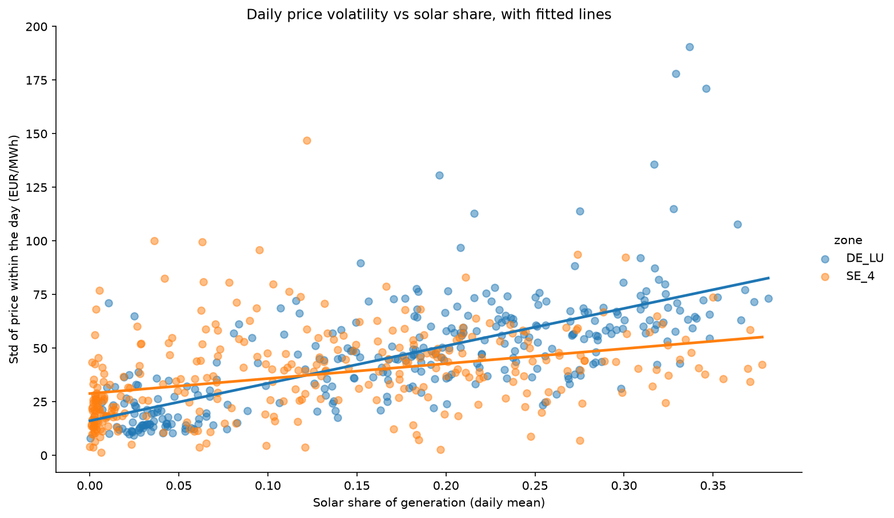
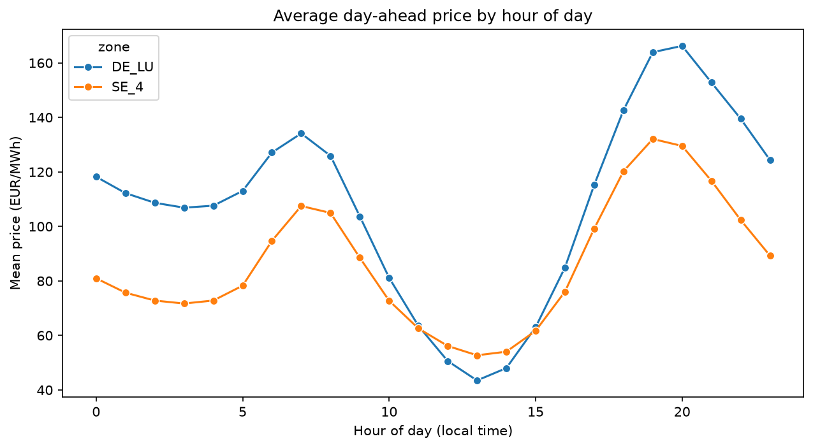
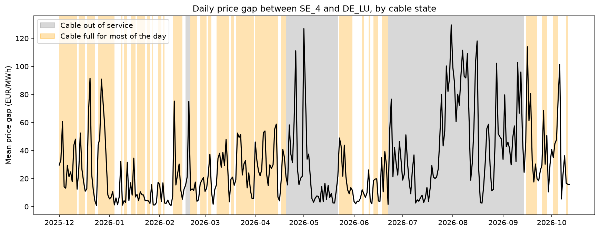
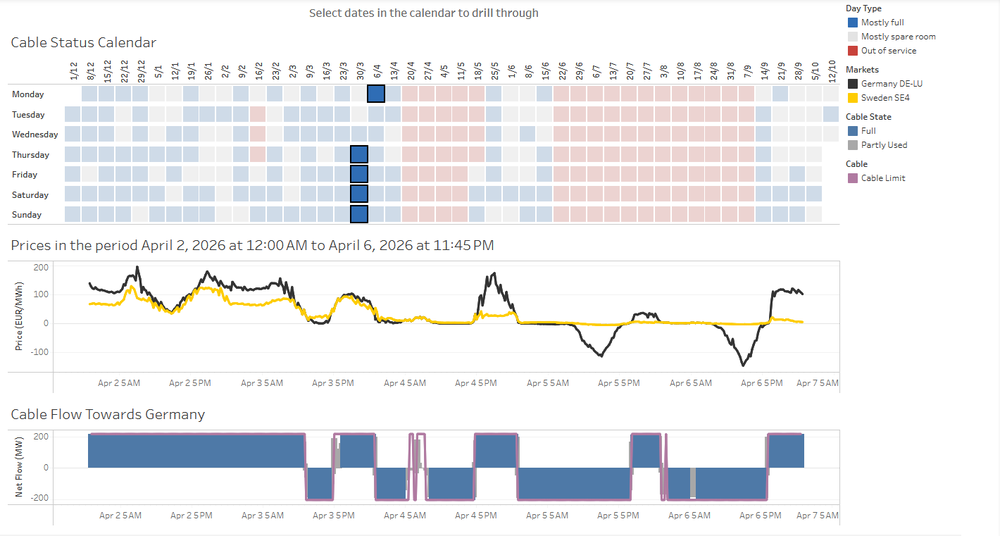

# Germany vs. Sweden: Energy Market Analysis (ENTSO-E)

How does variable renewable generation relate to electricity price volatility,
and how does the Baltic Cable interconnector shape price convergence between
Germany and southern Sweden?

This project pulls European electricity market data from the ENTSO-E
Transparency Platform, loads it into a SQLite database through a small ETL
pipeline, and runs two statistical analyses on it. A final script turns the
results into a plain-language findings report that rewrites itself on every
run.

Full plan, rationale and methodology: [`docs/project-brief.md`](docs/project-brief.md).

**Interactive dashboard:** [the Baltic Cable on Tableau Public](https://public.tableau.com/app/profile/niklas.livchitz/viz/energy-project_17920690448060/Cabledashboard).

## Questions

1. **Renewables and volatility:** does a higher share of variable renewables
   (wind + solar) go along with higher day-ahead price volatility, and is it different in Germany and Sweden?
   Answered below: it depends on which of the two, solar yes, wind no.
2. **Transmission price pressure:** do German (DE-LU) and southern Swedish (SE4)
   prices decouple when the Baltic Cable between them is congested? The hypothesis here is that the prices stay very close as long as the cable has spare capacity, and drift apart when it's full.
   Answered below: yes. With spare room the prices are nearly equal; with the cable
   full or out of service they drift apart by tens of euros.

## Status

- **ETL pipeline:** working. It fetches day-ahead prices (DE-LU, SE1–SE4),
  generation by source (DE-LU, SE4) and cross-border flows (DE-LU ↔ SE4) at
  15-minute resolution, and upserts them into SQLite. It also loads the
  outage and maintenance records for the cable. Reruns are idempotent.
- **Database:** about 850,000 rows in four tables as of mid-October 2026:
  about 150,000 prices (5 zones), 640,000 generation values (16 production
  types), 60,000 cable flows and 265 outage records. About 98 MB in SQLite.
- **Data window:** a rolling year up to the latest complete day, but never
  earlier than 2025-12-02, the first date ENTSO-E publishes every series here
  at 15-minute resolution. The results below use 2025-12-02 to 2026-10-12,
  about ten months, with no November yet.
- **Analysis 1 (renewables and volatility):** done, see below.
- **Analysis 2 (the Baltic Cable and price convergence):** done, see below.
- **Findings report:** done. A script turns the latest results into plain
  sentences, see [`outputs/report.md`](outputs/report.md).
- **Dashboard:** done, the cable analysis on [Tableau Public](https://public.tableau.com/app/profile/niklas.livchitz/viz/energy-project_17920690448060/Cabledashboard).
  See below.

## Findings: renewables and price volatility

Volatility here is the standard deviation of the 96 quarter-hourly prices
within a day. Shares are shares of the zone's own generation, averaged over
the day.

**The conclusions here in the readme might be dated by new data pulls so check the report.md**
What is here is based off of a one time run. The report.md will be generated when its corresponding
script is run. The same goes for the pictures, they might contradict the numbers shown in the text
here in case the market drastically changes.

**Wind and solar have to be looked at separately.** Their combined share is
almost unrelated to volatility (Spearman +0.24 in DE-LU, −0.05 in SE4),
because the two pull in opposite directions.

- **Solar goes with larger price swings in Germany.** Spearman correlation
  +0.73. In a regression with HAC standard errors, 10 percentage points more
  solar goes with about 18 EUR/MWh more daily volatility (p < 0.001). The
  effect holds with month controls (about 23 EUR/MWh) and with
  log-transformed volatility, so it is neither a seasonal artefact nor driven
  by a few extreme days.
- **Wind shows no effect in Germany** once solar is accounted for (p = 0.72).
- **SE4 is different.** Its solar effect is a third the size of Germany's and
  disappears with month controls. SE4 generates little of its own power and imports much of what
  it uses, so local shares explain less there.
- **SE4 has the higher wind and solar share** (71% of local generation against
  47% in Germany) and the calmer prices, the opposite of the starting
  assumption that Germany is the wind-and-solar market of the two.
  They are however highly dependent on imports from other markets within Sweden
  demonstrating how interconnected the markets are.


*Each dot is one day. Lines are fitted on solar share alone, per zone.*


*The mechanism: prices dip at midday, when solar output peaks. German prices
average about 44 EUR/MWh at 13:00 against 166 EUR/MWh at 20:00. SE4 shows the
same dip with almost no solar of its own.*

These are associations in ten months of data, not proof of cause. Regression
tables and the underlying daily table are in `outputs/tables/`.

## Findings: the Baltic Cable and price convergence

Every 15 minutes the cable is either out of service, full, or partly used.
"Full" is measured against the capacity available at the time, from ENTSO-E's
outage records.

- **Power mostly flows towards Germany:** 63% of the time the cable was in
  service, against 23% towards Sweden (idle the rest). That is about 700 GWh
  towards Germany against 235 GWh towards Sweden over the period. Power flows
  from the cheaper zone, so Sweden was usually the cheaper side, and Swedish
  power was pushing into the German market far more often than the reverse.
- **With spare room, the two prices are nearly the same:** a median gap of
  1.9 EUR/MWh, against 22.7 with the cable full and 15.8 with it out.
- **A full cable separates the markets about as much as a missing one:**
  roughly 40 and 36 EUR/MWh more gap per day, with month controls.
- **Direction matters:** full towards Germany, SE4 is cheaper (median 27
  EUR/MWh); full towards Sweden, SE4 is more expensive (median 12). The cable fills
  towards Sweden around midday, when German solar is strongest.


*Grey: cable out of service. Orange: full for most of the day.*

The two zones are also linked through Denmark, Poland and Lithuania, and a
full cable is partly a result of a price gap, so this shows an association,
not that this one cable sets the gap.

## Interactive dashboard

[**Open the dashboard on Tableau Public**](https://public.tableau.com/app/profile/niklas.livchitz/viz/energy-project_17920690448060/Cabledashboard)

[](https://public.tableau.com/app/profile/niklas.livchitz/viz/energy-project_17920690448060/Cabledashboard)
*The dashboard with 2 to 6 April 2026 selected (Easter). While the cable runs
full towards Germany, the German price stays above the Swedish one; on Easter
Sunday and Monday German prices go negative and the cable runs full towards
Sweden.*

A calendar shows the cable's state for every day: out of service, mostly
full, or mostly spare room. Click a day, or several, and the two charts below
show that period's prices in both zones and the flow on the cable against its
limit. Good days to try are 2 April 2026, when the prices only meet while the
cable has spare room, and 6 April (Easter Monday), when German prices go
negative and the cable runs full towards Sweden.

The dashboard uses data from 2 December 2025 to 14 October 2026 and does not
update by itself: Tableau Public can't read the database, so it is refreshed
by hand from the CSV files the analysis scripts write to `outputs/tables/`.

## The findings report: results that rewrite themselves

The findings above use data up to 12 October 2026 and stay as written. The
data keeps moving, though: the pipeline pulls a rolling year, so every run
shifts the numbers a little. Rather than rewriting the README after each run,
a script writes the conclusions itself:
[`outputs/report.md`](outputs/report.md).

`analysis/findings_report.py` runs last. It reads the result tables both
analyses write (correlations, regression coefficients, summary tables), fills
the current numbers into pre-written sentences, and lets simple rules choose
the wording. Every finding goes through the same four steps:

1. **Do they move together?** The Spearman correlation, put into words
   ("almost no link", "a moderate link", "a strong link").
2. **How big, and could it be chance?** The regression coefficient with its
   p-value, judged against a threshold of α = 0.05, using standard errors
   corrected for neighbouring days being alike (HAC).
3. **Two robustness checks:** is the effect still there with the season
   removed, and without the extreme days?
4. **A conclusion** that combines the three: "This holds up", "Treat with
   caution", "Tentative" or "No evidence of an effect".

Each line names the method behind it, the report opens with a short "how to
read this" for readers without a statistics background, and the charts sit
next to the findings they support. Nobody types a conclusion by hand: if a
result stops being significant after a data refresh, its wording changes on
the next run. An excerpt:

> **Solar share in DE_LU**
> - **Do they move together?** There is a strong positive link between solar
>   share and daily price volatility (correlation 0.73).
> - **How big, and could it be chance?** 10 percentage points more solar share
>   goes with +17.8 EUR/MWh daily volatility (a clear effect, p < 0.001).
> - **With the season removed:** still there (p < 0.001).
> - **Without the extreme days:** still there (p < 0.001).
> - **Conclusion:** This holds up. It is clear in the main test and survives
>   both checks.

The same rules reach a different verdict for southern Sweden: its solar
effect is clear at first, but disappears once the season is accounted for, so
the report says "Treat with caution". The rules only say what they were
written to say; spotting something new is still a job for a person reading
the tables.

## Structure

```
run_all.py           Runs everything in order: pipeline, both analyses, findings report
src/                 ETL pipeline: ENTSO-E client, fetch → transform → load, shared helpers
analysis/            The two analyses and the findings report (read from the database and outputs, no API calls)
db/                  SQLite schema (the database file itself is not committed)
docs/                Project brief: rationale, methodology, decisions
outputs/figures/     Exported charts
outputs/tables/      Result tables, one folder per analysis: daily CSVs, summaries, regression results
outputs/report.md    Findings report, regenerated on every run
```

## Quickstart

1. Get an ENTSO-E API key (register at transparency.entsoe.eu, then request
   API access by email; see brief Section 2) and put it in a `.env` file in the
   repo root:
   ```
   ENTSOE_API_KEY=your-token-here
   ```
2. Create a virtual environment, activate it, and install the dependencies:
   ```
   python -m venv .venv
   source .venv/Scripts/activate
   pip install -r requirements.txt
   ```
   The activate line is for Git Bash on Windows; on Mac or Linux it is
   `source .venv/bin/activate`. Activate it again in every new terminal.
3. Run everything from the repo root:
   ```
   python run_all.py
   ```
   This runs the pipeline (creates or updates `db/energy.db`), both analyses
   and the findings report. Each part can also be run on its own, e.g.
   `python -m src.pipeline` or `python -m analysis.transmission_price_pressure`.


## Tech

Python · entsoe-py · pandas · SQLite + SQLAlchemy · statsmodels · seaborn/matplotlib

## Data

Data from the [ENTSO-E Transparency Platform](https://transparency.entsoe.eu),
licensed CC-BY 4.0. The raw data isn't committed to this repo. Run
`run_all.py` with your own API key to reproduce it.
