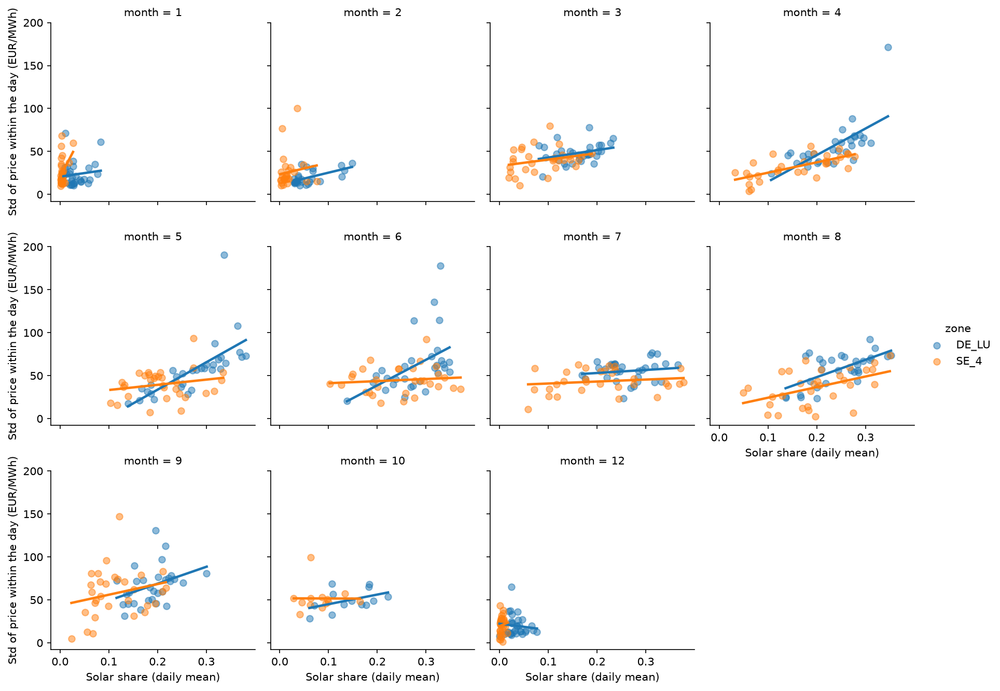
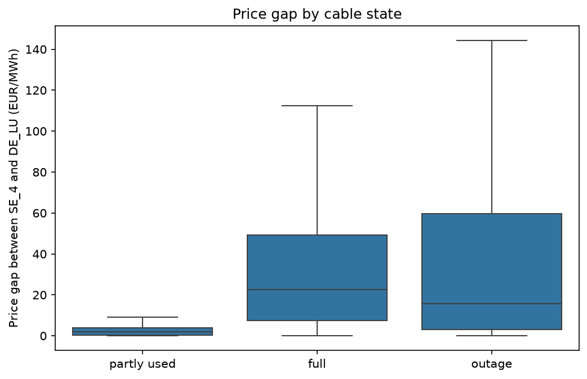
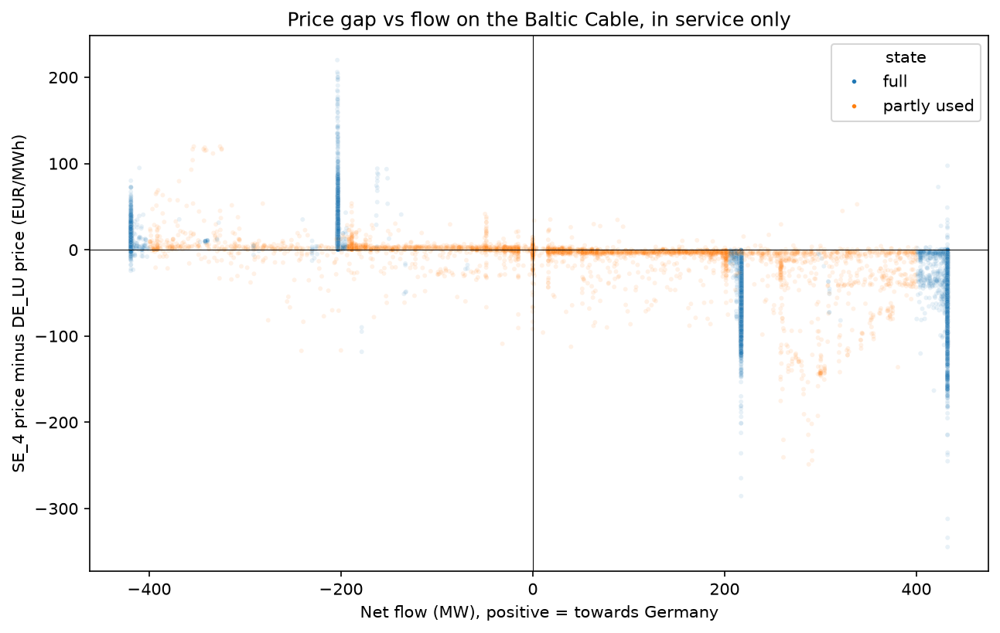

# Findings report

Generated by `analysis/findings_report.py` from the tables in `outputs/tables/`. It always reflects the latest run of the two analyses. The README and the project brief describe one fixed period in more detail.

## How to read this

- **Correlation** runs from -1 to +1. Near 0 means no link; near +1 or -1 means the two move closely together or opposite. Spearman's version compares rankings, so a few extreme days cannot dominate it.
- **Regression** estimates how much one thing changes when another changes, holding the other inputs equal.
- **p-value:** the chance of seeing an effect this large if there were none. Below 0.05 counts as a clear effect here.
- **HAC correction:** neighbouring days resemble each other, which makes ordinary p-values too confident. The correction accounts for that.
- **The two checks** test whether a result is really the season, or really a handful of extreme days.
- None of this proves that one thing causes the other.

## Wind, solar and price volatility

Data from 2025-12-01 to 2026-10-13. Volatility is the standard deviation of the 15-minute prices within a day. Shares are shares of the zone's own generation.

- **Wind and solar combined, DE_LU:** almost no link with daily volatility (correlation 0.24). The two are looked at separately below, because they can pull in opposite directions.
- **Wind and solar combined, SE_4:** almost no link with daily volatility (correlation -0.05). The two are looked at separately below, because they can pull in opposite directions.

### Solar share in DE_LU

- **Do they move together?** There is a strong positive link between solar share and daily price volatility (correlation 0.74). *Method: Spearman rank correlation on daily values.*
- **How big, and could it be chance?** 10 percentage points more solar share goes with +17.8 EUR/MWh daily volatility (a clear effect, p < 0.001). *Method: linear regression on daily values, with standard errors corrected for day-to-day dependence (HAC).*
- **With the season removed:** still there (p < 0.001). *Method: the same regression with the calendar month added as a control.*
- **Without the extreme days:** still there (p < 0.001). *Method: the same regression on the logarithm of the outcome, which shrinks extreme days.*
- **Conclusion:** This holds up. It is clear in the main test and survives both checks.

### Wind share in DE_LU

- **Do they move together?** There is a moderate negative link between wind share and daily price volatility (correlation -0.33). *Method: Spearman rank correlation on daily values.*
- **How big, and could it be chance?** 10 percentage points more wind share goes with +0.4 EUR/MWh daily volatility (not distinguishable from zero, p = 0.727). *Method: linear regression on daily values, with standard errors corrected for day-to-day dependence (HAC).*
- **With the season removed:** not there (p = 0.471). *Method: the same regression with the calendar month added as a control.*
- **Without the extreme days:** not there (p = 0.551). *Method: the same regression on the logarithm of the outcome, which shrinks extreme days.*
- **Conclusion:** No evidence of an effect. The link in the first line is indirect: it goes away once the other share is taken into account.

### Solar share in SE_4

- **Do they move together?** There is a moderate positive link between solar share and daily price volatility (correlation 0.47). *Method: Spearman rank correlation on daily values.*
- **How big, and could it be chance?** 10 percentage points more solar share goes with +6.0 EUR/MWh daily volatility (a clear effect, p < 0.001). *Method: linear regression on daily values, with standard errors corrected for day-to-day dependence (HAC).*
- **With the season removed:** not there (p = 0.671). *Method: the same regression with the calendar month added as a control.*
- **Without the extreme days:** still there (p < 0.001). *Method: the same regression on the logarithm of the outcome, which shrinks extreme days.*
- **Conclusion:** Treat with caution. It is clear in the main test but disappears once the season is accounted for, so it may just reflect the time of year.

### Wind share in SE_4

- **Do they move together?** There is almost no link between wind share and daily price volatility (correlation -0.30). *Method: Spearman rank correlation on daily values.*
- **How big, and could it be chance?** 10 percentage points more wind share goes with -1.4 EUR/MWh daily volatility (not distinguishable from zero, p = 0.139). *Method: linear regression on daily values, with standard errors corrected for day-to-day dependence (HAC).*
- **With the season removed:** still there (p = 0.003). *Method: the same regression with the calendar month added as a control.*
- **Without the extreme days:** still there (p = 0.038). *Method: the same regression on the logarithm of the outcome, which shrinks extreme days.*
- **Conclusion:** Tentative. It is not clear in the main test, but shows up once the season is accounted for.

*Each dot is one day. The lines are fitted on solar share alone, one per zone; a steeper line means a bigger solar effect.*

*The same, one panel per month. This is what the season check looks at: does the pattern hold within a month?*

*The average price at each hour of the day. The midday dip is when solar output peaks.*

### Do the zones differ?

- **Solar share, SE_4 compared with DE_LU:** the effect differs by -11.8 EUR/MWh per 10 percentage points (a clear effect, p < 0.001). *Method: one regression over all zones, with a separate slope per zone.*
- **Wind share, SE_4 compared with DE_LU:** the effect differs by -1.8 EUR/MWh per 10 percentage points (not distinguishable from zero, p = 0.227). *Method: one regression over all zones, with a separate slope per zone.*

## The Baltic Cable and the price gap

Data from 2025-12-01 to 2026-10-13. Every 15 minutes the cable is out of service, full, or partly used. The price gap is the difference between the Swedish (SE_4) and German (DE_LU) price.

*The daily price gap. Grey: cable out of service. Orange: cable full for most of the day. White: spare room for most of the day.*

### Cable full

- **First look:** the typical price gap is 22.5 EUR/MWh with the cable full, against 2.0 with spare room. The cable is in this state 39% of the time. *Method: median price gap over all 15-minute intervals in each cable state.*
- **How big, and could it be chance?** On a day spent entirely in this state, the price gap differs by +33.8 EUR/MWh from a day with spare room throughout (a clear effect, p < 0.001). *Method: linear regression on daily values, with standard errors corrected for day-to-day dependence (HAC).*
- **With the season removed:** still there (p < 0.001). *Method: the same regression with the calendar month added as a control.*
- **Without the extreme days:** still there (p < 0.001). *Method: the same regression on the logarithm of the outcome, which shrinks extreme days, month control included.*
- **Conclusion:** This holds up. It is clear in the main test and survives both checks.

### Cable out of service

- **First look:** the typical price gap is 15.8 EUR/MWh with the cable out of service, against 2.0 with spare room. The cable is in this state 39% of the time. *Method: median price gap over all 15-minute intervals in each cable state.*
- **How big, and could it be chance?** On a day spent entirely in this state, the price gap differs by +38.1 EUR/MWh from a day with spare room throughout (a clear effect, p < 0.001). *Method: linear regression on daily values, with standard errors corrected for day-to-day dependence (HAC).*
- **With the season removed:** still there (p < 0.001). *Method: the same regression with the calendar month added as a control.*
- **Without the extreme days:** still there (p < 0.001). *Method: the same regression on the logarithm of the outcome, which shrinks extreme days, month control included.*
- **Conclusion:** This holds up. It is clear in the main test and survives both checks.

*The price gap in each cable state. The box holds the middle half of all 15-minute intervals, the line in it is the median.*

### Which way the cable is full

The price gap here is the Swedish price minus the German price, so a negative number means Sweden is cheaper.

- **Full towards Germany:** the typical gap is -27.4 EUR/MWh (9049 intervals, most often around 4:00 local time). *Method: median over the 15-minute intervals with the cable full in this direction.*
  In the daily test, a day spent entirely full in this direction shifts the gap by -45.3 EUR/MWh (a clear effect, p < 0.001). *Method: linear regression on daily values, with standard errors corrected for day-to-day dependence (HAC), month control included.*
- **Full towards Sweden:** the typical gap is +12.2 EUR/MWh (2648 intervals, most often around 13:00 local time). *Method: median over the 15-minute intervals with the cable full in this direction.*
  In the daily test, a day spent entirely full in this direction shifts the gap by +12.1 EUR/MWh (not distinguishable from zero, p = 0.195). *Method: linear regression on daily values, with standard errors corrected for day-to-day dependence (HAC), month control included.*

*Each dot is 15 minutes with the cable in service. With spare room the gap sits near zero; full towards Germany it is below zero, full towards Sweden above.*

Keep in mind: the two zones are also connected through other countries, and a full cable is partly a result of a price gap, not only a cause. The outage periods are the stronger evidence.
